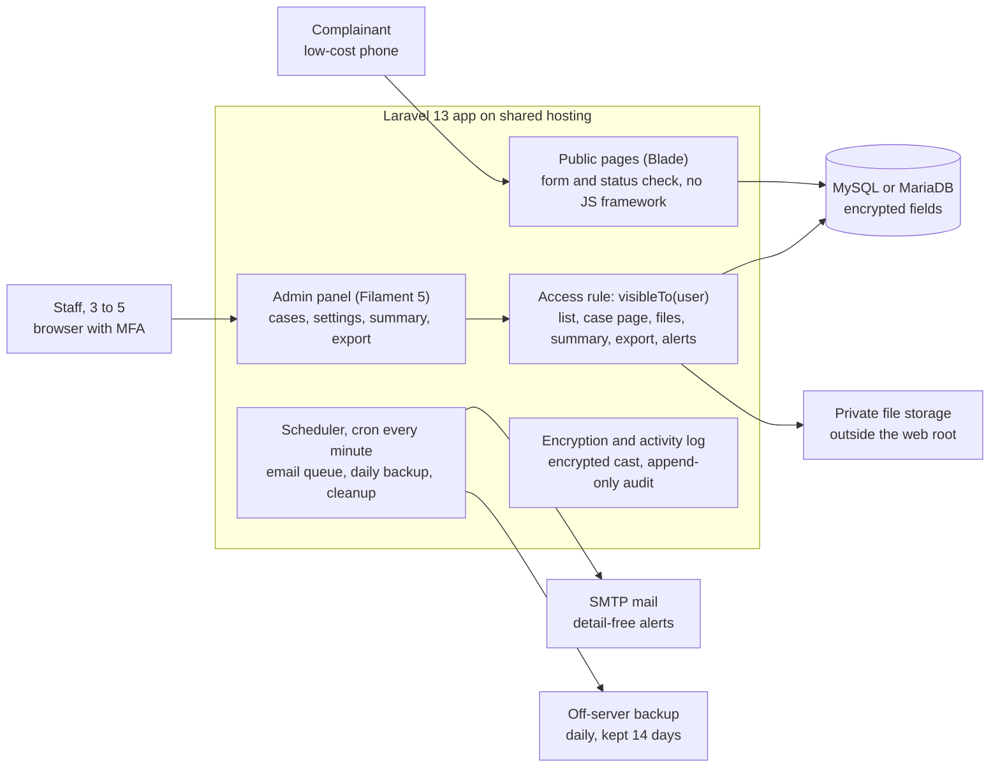

# GHM System: Implementation Plan (NBI/GHM/RFQ/01)

Plan dated 30 Oct 2026. This file is a Markdown copy of the shared plan doc (revision 26), kept at `docs/implementation-plan.md` so coding agents can read it. The shared doc stays the source of truth: when the doc changes, regenerate this file. Diagrams are rendered here as a Mermaid chart and a dated table, and the checklist's status column lives in the doc and in `docs/requirements-traceability.md`.

## 1. Summary

Recommended build: one Laravel application with plain Blade public pages and a Filament admin panel, on MySQL, deployed to the company's existing shared hosting with no Node or build step on the server. It covers every mandatory item with the least custom code, adds both desirable items (P10 QR posters, S10 two-factor login) at little extra cost, and S3's "framework's built-in encryption" maps directly to Laravel's `encrypted` cast.

The main risk is the calendar, not the software. Kick-off on 8 Nov falls on Laxmi Puja, Tihar public holidays run 8 to 11 Nov, and Chhath is 15 Nov, so roughly six working days remain before the 18 Nov test version. The plan answers this by making categories, locations and notice text configurable (A7), so kick-off decisions become data entry instead of code changes, and by scaffolding the generic parts before contract signing.

How to review this plan:

- Sections 2 and 3: confirm the requirement extract and pick an option.
- Sections 4 to 7: stack, repositories, data and security design, and how the agent skills are used.
- Sections 8 to 10: timeline, the requirement-by-requirement verification checklist, handover and bid checklist.
- Section 11: questions to send NBI before the 2 Nov clarification deadline.

## 2. Requirements extracted from the RFQ

NBI, under UNDP Nepal's Access to Justice project, wants a small purpose-built grievance system for one manufacturer (head office in Kathmandu, plant outside the Valley), live on the company's website by 27 Nov 2026. The RFQ has 31 requirement IDs: 29 mandatory and 2 desirable (P10, S10). The company is named only to the selected vendor.

| Item | Detail |
| --- | --- |
| Reference | NBI/GHM/RFQ/01 |
| Quotation deadline | 4 Nov 2026, 17:00 NPT; one email to the address in RFQ section 1, subject "RFQ NBI/GHM/RFQ/01 – [Company name]" |
| Questions deadline | 2 Nov 2026, by email |
| Quote validity | 60 days |
| Award rule | Lowest total including 13% VAT that meets every mandatory item; experience and desirable items only break near-ties |
| Contract | Fixed price with NBI; confidentiality, data protection, UN Supplier Code of Conduct; no subcontracting without written consent |
| Payment | 100% after NBI and the company accept go-live and handover |
| Ownership | Company gets source code and full rights to use, modify and host; company owns all grievance data |
| Recurring costs | Hosting, domain, email sending paid by the company; new hosting quoted per year in Annex A item 5 |

**Functional scope.** Public side: mobile-first bilingual form (Nepali and English), anonymous or named, one attachment, reference number plus PIN, and a status page with two-way messages (P1 to P10). Admin side: 3 to 5 staff in three roles, case list and case page, restricted cases, offline entry, settings (A1 to A7). Reports: detail-free email alerts, complainant acknowledgement, summary counts, CSV/Excel export with personal data off by default (N1 to N4). Security: HTTPS, hashed passwords with lockout and idle logout, field encryption, private files, no IP for anonymous cases, audit log, daily backups for 14 days, 24-hour breach reporting under the Individual Privacy Act 2075, basic accessibility (S1 to S10).

**Technical constraints.** A common, well-supported framework another developer can maintain; runs on ordinary shared or low-cost hosting with MySQL or PostgreSQL, preferably the company's existing host; linked from the company site by subdomain or button; light public pages with no heavy scripts; free open-source libraries.

**RFQ milestones.** Contract and kick-off 8 Nov; test version 18 Nov; UAT, fixes and retest 20 to 25 Nov; training 25 Nov (one session, about 2 hours, in Nepali); go-live and handover 27 Nov; support 27 Nov 2026 to 26 Nov 2027.

**Deliverables at handover.** Source code (Git or zip) and database structure; all admin, hosting and database credentials; a 3 to 5 page user guide for focal persons; a one-page technical note (framework and version, libraries, install, backup and restore). UAT issues must be fixed within 2 working days.

**Support for 12 months.** Faults fixed free; framework and library security updates applied; response within 1 working day for critical issues (system down, data at risk) and 3 working days for others.

**Implied requirements the RFQ leaves open.** Each one is handled in section 6 and raised in section 11.

- A2's "15 working days" needs a weekend rule and a holiday list.
- P5's incident date: many workers think in Bikram Sambat (BS) dates, not AD.
- S5 reaches past the app: Laravel's database session table and the host's access logs both record IP addresses.
- Photos carry EXIF data (GPS, phone model) that can identify an anonymous complainant.
- S3 encryption depends on one key; losing it makes every encrypted field unreadable, so the key needs its own backup and handover step.
- P8's reference plus PIN lookup needs brute-force protection.

## 3. Options compared

Option A (Laravel 13 with a Filament 5 admin panel) is the recommendation: it has the lowest build effort, which matters because NBI awards to the lowest compliant price, and it is the only option where S3 encryption and S10 two-factor login are both built in. Build-day figures below are one-developer estimates for section 3 only, before UAT and training. Sections 4 to 11 are written for Option A.

| Option | Shared-hosting fit | S3 built-in encryption | S10 two-factor | Est. build days | Main risk | Verdict |
| --- | --- | --- | --- | --- | --- | --- |
| **A. Laravel 13 + Filament 5 admin + Blade public pages** | Strong: plain PHP 8.3+, runs on most cPanel hosts | Yes, `encrypted` cast | Yes, Filament's built-in MFA | 9 to 11 | Maintainer must learn Filament conventions; Filament majors move yearly | **Recommended** |
| B. Laravel 13 + hand-built Blade admin | Strong | Yes | Needs Laravel Fortify wiring and custom screens | 14 to 17 | Higher price; more custom UI code to test and support | Fallback if NBI objects to an admin framework |
| C. Django 5.2 LTS + Django admin | Weak: needs Passenger or a Python app selector on the host | No, third-party package needed, which conflicts with S3's wording | Third-party package | 12 to 14 | Hosting may not support Python; S3 compliance argument | Only if the company's host is Python-ready |
| D. Next.js or another Node stack | Poor: needs a Node runtime, rare on low-cost Nepali shared plans | No | Third-party | 14+ | Heavier client JS works against the light-pages rule | Rejected |
| E. Adapt an open-source helpdesk (osTicket, GLPI) | Good | Partial | Varies | 10 to 15 incl. rework | RFQ asks for purpose-built; anonymous reference plus PIN and the restricted-case model fight the ticketing model | Rejected |

**Why A over B.** Both are Laravel, so maintainability is similar. Filament gives the case table, filters, forms, user management, login and MFA for free, which removes about a week of custom admin work. The admin side is used by 3 to 5 staff on office computers, so Filament's JavaScript weight does not touch the light-pages rule; that rule applies to the public pages, which stay plain Blade in both options.

**Hosting sub-choice.** H1: the company's existing shared hosting, if it offers PHP 8.3 or newer, MySQL 8 or MariaDB 10.6+, cron, SSH or Git deploy, and a subdomain with AutoSSL. H2: a low-cost VPS or a better shared plan, quoted per year under Annex A item 5, only if H1 fails that check. The app is identical on both.

**Support window check.** Laravel 13 gets security fixes until 17 March 2028, which covers the whole support period to 26 Nov 2027 ([Laravel release notes](https://laravel.com/docs/13.x/releases)).

## 4. Recommended stack

Everything below is free and open source, installs through Composer (the Playwright test tools through npm, on dev and CI machines only), and needs no Node.js or build step on the server, so a future maintainer only needs PHP and SSH or SFTP access.

| Layer | Choice | Why | Covers |
| --- | --- | --- | --- |
| Runtime | PHP 8.3 minimum, 8.4 preferred | Laravel 13 supports PHP 8.3 to 8.5 | All |
| Framework | Laravel 13.x | Most common PHP framework; security fixes to Mar 2028 | All |
| Admin panel | Filament 5.x (bundles Livewire 4) | Tables, filters, forms, auth, MFA ready-made; assets published as static files | A1 to A7, N3, S10 |
| Public UI | Blade, one hand-written CSS file (target under 15 KB), about 2 KB of vanilla JS, no framework | Works without JS; fast on low-cost phones | P1 to P9, S9 |
| Fonts | System font stack with Devanagari fallback; no web font download | Saves 50 to 150 KB per page | P1, P2 |
| Database | MySQL 8.0+ or MariaDB 10.6+ | Standard on shared hosting | All |
| Sessions and cache | `file` driver | The `database` session driver stores IP and user agent, which breaks S5 | S2, S5 |
| Queue | `database` driver, worked by cron | Emails never block or break a submission | N1, N2 |
| Field encryption | Laravel `encrypted` cast (AES-256 with MAC, keyed by `APP_KEY`) | The RFQ asks for the framework's built-in encryption | S3 |
| Passwords | Laravel `hashed` cast (bcrypt) | Framework default | S2 |
| Two-factor | Filament built-in MFA, authenticator-app codes | No extra package | S10 |
| Audit log | spatie/laravel-activitylog | Standard, append-only table | S6 |
| Backups | spatie/laravel-backup | Daily DB dump, 14-day retention, off-server copy | S7 |
| Export | openspout/openspout | Streams CSV and XLSX with low memory | N4 |
| Image cleaning | intervention/image (GD) | Re-encodes photos to strip EXIF location and device data | S4, S5 |
| Spam | spatie/laravel-honeypot plus Laravel rate limiting | No third-party script, no IP sent to Google; self-hosted ALTCHA proof-of-work held in reserve | P9, S5 |
| QR code | bacon/bacon-qr-code | Pure PHP SVG and PNG output | P10 |
| Mail | Laravel Mail over the company's SMTP or a transactional provider's free tier | SPF and DKIM on the company domain keep alerts out of spam | N1, N2, P7 |
| Tests | Pest 4 with the Laravel plugin for unit and feature tests; Playwright Test with axe-core for end-to-end runs; Playwright CLI for agent-driven checks; all dev only, Node 20+ | Each test tagged with its requirement ID | Section 9 |
| Code quality | Laravel Pint, Larastan | Style and static checks in CI | Maintainability |
| CI | GitHub Actions or GitLab CI, whichever the company will own | Runs Pint, Larastan, Pest and the Playwright suite on every push | Section 9 |
| Monitoring | Laravel's `/up` route with a free uptime monitor | Needed to meet the 1-working-day critical response | Support |

**Deployment shape.** CI builds a release (`composer install --no-dev`, Filament assets published, config cached) and it is pushed by Git or rsync over SSH. The web root points at `public/`; on hosts that force `public_html`, the app sits one level above it and only `public/` contents go inside. One cron line runs `php artisan schedule:run` every minute, which drives the queue, backups and cleanup.

**Architecture: every staff screen reaches case data through one access rule.**



The public side writes new cases straight to the database and reads them back only by reference and PIN; every staff path goes through the one access rule, which is why section 6 tests it from every screen.

## 5. Repositories and folder structure

Two repositories: `ghm-app` holds the application and is what the company receives; `ghm-delivery` is your private workspace for the bid, UAT evidence, training and support records. Secrets live in neither; credentials are handed over through a password manager or sealed handover sheet.

| Repo | Owner after go-live | Contents | Branching |
| --- | --- | --- | --- |
| `ghm-app` | The company (transferred at handover) | Laravel app, tests, CI, technical docs, dev-only agent config | `main` protected; short feature branches; tag `v1.0.0` at go-live, patch tags during support |
| `ghm-delivery` | You | Proposal, Annex A, signed statements, kick-off decisions, UAT log, training, user guide source, support log | Single branch |

Three environments: local (your machine), staging at a test subdomain on the company host with fake data only (the 18 Nov UAT version), and production.

### ghm-app

```text
ghm-app/
├── app/
│   ├── Enums/                      # Status, Priority, Channel, Role, Recurrence, ContactMethod,
│   │                               # ComplainantType, Sex, AgeGroup, Ethnicity, Disability
│   ├── Filament/
│   │   ├── Pages/
│   │   │   ├── Auth/Login.php      # 5 failed logins = 15-minute lock (S2)
│   │   │   ├── Summary.php         # counts by status and category (N3)
│   │   │   ├── ExportCases.php     # date range, personal-data toggle for Administrator (N4)
│   │   │   └── QrPoster.php        # QR code and printable poster (P10)
│   │   └── Resources/
│   │       ├── Grievances/         # list, offline entry, case page (A2, A3, A6)
│   │       │   ├── GrievanceResource.php
│   │       │   ├── Pages/
│   │       │   ├── Schemas/
│   │       │   ├── Tables/
│   │       │   └── RelationManagers/   # Notes, Messages, Attachments
│   │       ├── Users/              # A7
│   │       ├── Categories/         # A7, restricted flag
│   │       ├── Locations/          # A7
│   │       └── Holidays/           # working-day calendar (A2)
│   ├── Http/
│   │   ├── Controllers/
│   │   │   ├── Public/SubmitGrievanceController.php
│   │   │   ├── Public/StatusController.php
│   │   │   ├── Public/LocaleController.php
│   │   │   └── AttachmentController.php    # authorised file streaming (S4)
│   │   ├── Middleware/
│   │   │   ├── SetLocale.php
│   │   │   └── SecurityHeaders.php         # HSTS, CSP, no-referrer (S1)
│   │   └── Requests/                       # StoreGrievance, StatusLookup, ComplainantReply
│   ├── Models/                     # Grievance, GrievanceMessage, GrievanceNote, Attachment,
│   │                               # Category, Location, Holiday, User, ReferenceCounter
│   ├── Notifications/              # NewCaseAlert, ComplainantMessageAlert, Acknowledgement
│   ├── Observers/GrievanceObserver.php     # restricted flag, closed_at, audit entries
│   ├── Policies/GrievancePolicy.php        # role and restricted-case rules (A1, A5)
│   ├── Providers/
│   │   ├── AppServiceProvider.php
│   │   └── Filament/AdminPanelProvider.php # MFA, session, branding
│   └── Support/
│       ├── ReferenceNumber.php     # GHM-2026-0001 from a row-locked counter (P7)
│       ├── Pin.php                 # random 6-digit PIN, stored hashed (P7, P8)
│       ├── WorkingDays.php         # weekend rule plus holiday table (A2)
│       ├── BsDate.php              # Bikram Sambat to AD conversion (P5)
│       ├── ImageSanitizer.php      # re-encode photos, strip EXIF (S5)
│       └── CaseExport.php          # CSV and XLSX writer (N4)
├── bootstrap/app.php               # middleware, rate limiters, exception handling
├── config/ghm.php                  # SLA days, PIN length, upload limits, weekend days
├── database/
│   ├── migrations/
│   ├── factories/
│   └── seeders/                    # categories, locations, first Administrator
├── docs/
│   ├── implementation-plan.md      # this file
│   ├── technical-note.md           # one-page handover note
│   ├── restore.md                  # S7 restore steps
│   ├── deploy.md
│   └── requirements-traceability.md    # requirement ID, code, test
├── lang/
│   ├── en.json                     # UI strings
│   ├── ne.json
│   ├── en/validation.php
│   └── ne/validation.php
├── public/
│   ├── index.php
│   ├── css/public.css              # the only public stylesheet
│   ├── js/form.js                  # progressive enhancement only
│   └── robots.txt                  # disallow admin and status pages
├── resources/views/
│   ├── layouts/public.blade.php
│   ├── public/                     # form, submitted, status-lookup, status
│   ├── components/                 # field, radio-group, notice, error-summary
│   ├── mail/                       # detail-free alerts, acknowledgement
│   └── print/                      # offline receipt slip, QR poster
├── routes/
│   ├── web.php
│   └── console.php                 # schedule: queue, backup, cleanup
├── storage/app/private/attachments/    # outside the web root (S4)
├── tests/
│   ├── Feature/Public/
│   ├── Feature/Admin/
│   ├── Feature/Security/
│   ├── e2e/                        # Playwright specs tagged by requirement ID, dev only
│   └── Pest.php
├── .claude/                        # project-scoped skills and settings (dev only)
├── .impeccable/                    # impeccable shared config (dev only)
├── CLAUDE.md                       # Karpathy guidelines plus project rules (dev only)
├── PRODUCT.md                      # impeccable product context (dev only)
├── DESIGN.md                       # impeccable visual system (dev only)
├── .github/workflows/ci.yml        # Pint, Larastan, Pest, Playwright
├── .gitattributes                  # export-ignore for dev-only paths
├── playwright.config.ts            # mobile and desktop projects, base URL per environment (dev only)
├── package.json                    # dev only: @playwright/test, @playwright/cli, @axe-core/playwright
├── .env.example
├── composer.json
└── README.md
```

The dev-only paths are marked `export-ignore`, so a `git archive` handover zip contains only the application. Whether the Git history keeps them is a handover decision (section 11).

### ghm-delivery

```text
ghm-delivery/
├── bid/
│   ├── proposal.md                 # 2 to 3 pages, exported to PDF
│   ├── annex-a-price.xlsx
│   ├── statements/                 # signed conflict-of-interest and sanctions statement
│   └── company-docs/               # registration, PAN/VAT, tax clearance
├── kickoff/decisions.md            # fields, categories, locations, notice text, hosting facts
├── uat/
│   ├── uat-log.xlsx                # issue, found, fixed, retested (2-working-day rule)
│   └── evidence/                   # Playwright screenshots, videos, HTML reports per ID
├── training/                       # Nepali slides, attendance
├── handover/
│   ├── user-guide.docx             # 3 to 5 pages for focal persons
│   ├── handover-checklist.md
│   └── credentials-procedure.md    # how secrets are passed, never the secrets
└── support/
    ├── incident-log.md
    └── breach-report-template.md   # 24-hour notice to NBI and the company (S8)
```

## 6. Data model, access rules and security design

One rule carries most of the risk: who can see a case. It lives in a single query scope, `Grievance::visibleTo($user)`, used by the case list, case page, attachment download, summary, export and alert recipients, so no screen can apply its own version.

### Data model

| Table | Key fields | Encrypted | Notes |
| --- | --- | --- | --- |
| `grievances` | reference, pin_hash, channel, is_anonymous, name, phone, email, preferred_contact, category_id, location_id, incident_date, recurrence, description, complainant_type, sex, age_group, ethnicity, disability, status, priority, assigned_to, manually_restricted, is_restricted, locale, received_at, closed_at, created_by | name, phone, email, description (S3); demographic fields too, beyond S3 | No IP or user-agent column exists (S5). Days open is computed, not stored |
| `grievance_messages` | grievance_id, direction, body, author_id | body | Two-way thread shown on the status page (A3, P8) |
| `grievance_notes` | grievance_id, user_id, body, created_at | body | Never loaded by any public route; no edit or delete (A3) |
| `attachments` | grievance_id, message_id, uploaded_by, stored_name, original_name, mime, size | original_name | Random stored name under `storage/app/private` (S4) |
| `categories` | name_en, name_ne, is_restricted, is_active, sort | No | Turning on is_restricted re-flags existing cases (A5, A7) |
| `locations` | name_en, name_ne, is_active, sort | No | A7 |
| `holidays` | date, name | No | Feeds the working-day count (A2) |
| `users` | name, email, password, role, is_active, MFA secret and recovery codes | MFA secret | A1, S2, S10 |
| `reference_counters` | year, last_number | No | Row-locked, so two submissions in the same second never share a number (P7) |
| `activity_log` | causer, subject, event, properties, created_at | No content stored, only IDs and event names | S6; no UI to edit or delete |

`is_restricted` is set by an observer as "category is restricted OR manually restricted" on every save. Removing a manual restriction is Administrator-only.

### Access by role

| Capability | Administrator | Focal person | Restricted-case officer |
| --- | --- | --- | --- |
| See non-restricted cases | Yes | Yes | No |
| See restricted cases | Yes | No | Yes |
| Status, priority, assign, notes, reply, upload | Yes | On visible cases | On visible cases |
| Mark a case restricted | Yes | Yes, with a warning that the case leaves their view | Yes |
| Remove a restricted mark | Yes | No | No |
| Enter an offline case (A6) | Yes | Yes | Yes |
| New-case and new-message alerts (N1) | Opt-in setting | Non-restricted cases | Restricted cases |
| Summary page (N3) | All cases | Visible cases | Visible cases |
| Export (N4) | All cases; may include names and contacts | Visible cases; never names or contacts | Visible cases; never names or contacts |
| Settings: users, categories, locations, holidays | Yes | No | No |
| Activity log | Yes | No | No |

Assignment only offers users who can see the case, so a restricted case can never be assigned to a focal person.

### Security design by requirement

- **S1 HTTPS.** AutoSSL or Let's Encrypt on the subdomain; the app forces HTTPS and sends HSTS; cookies are Secure, HttpOnly and SameSite=Lax.
- **S2 passwords and sessions.** Bcrypt hashing. A custom Filament login locks an account for 15 minutes after 5 failures, keyed by email. `SESSION_LIFETIME=30` gives the idle logout; Filament's notification polling is switched off because a poll every 30 seconds would keep an idle session alive forever. A small script returns idle users to the login page at 30 minutes.
- **S3 encryption.** Laravel `encrypted` casts on every sensitive field. Losing `APP_KEY` means losing the data, so the key is stored in the company's password manager, apart from database backups. `APP_PREVIOUS_KEYS` allows rotation later. Admin search works on reference number only.
- **S4 files.** Stored outside the web root with random names. A controller checks the case policy, streams the file as a download with `nosniff`, and logs the view. Uploads are checked by real MIME type (JPEG, PNG, PDF), capped at 5 MB.
- **S5 no IP or device data.** No IP or user-agent columns; file sessions instead of database sessions; IPs stripped from log context. Rate-limit keys use a hash of the IP with a daily-rotated salt, kept in cache for under a day. Photos are re-encoded to remove EXIF location and phone model. Public pages load no third-party scripts, fonts or analytics, since each would receive the visitor's IP. Host access logs are outside the app and go to section 11.
- **S6 activity log.** Events: created, viewed, status changed, priority changed, assigned, note added, reply sent, attachment uploaded or viewed, restriction changed, exported (with filters and whether personal data was included), login and failed login.
- **S7 backups.** Daily database and private-file backup at 01:00 NPT, password-protected archive, 14-day retention, with a second copy off the web server. A restore drill on staging before go-live produces `docs/restore.md`.
- **S8 vendor conduct.** Staging uses fake data only; any production access needs written permission from the company each time; a breach-report template is ready for the 24-hour notice.
- **S9 accessibility.** Semantic HTML, a label on every field, fieldset and legend for radio groups, an error summary linked to fields, a `lang` attribute that follows the language switch, visible focus, 4.5:1 text contrast, 44 px touch targets, and the whole form works without JavaScript.
- **S10 two-factor.** Filament's built-in authenticator-app MFA, required for every admin user, with recovery codes.
- **P8 status lookup.** Reference and PIN go by POST, never in the URL. Five wrong PINs lock that reference for 15 minutes. The status view lives in a 10-minute session, and `Referrer-Policy: no-referrer` stops the page leaking to other sites.
- **P9 spam.** Honeypot field, minimum fill time and a per-hour submission limit. Self-hosted ALTCHA proof-of-work can be switched on if spam gets through, without any Google script.
- **Headers.** A strict Content Security Policy on public pages (self only, no inline script) and a Filament-compatible policy on the admin side; `frame-ancestors 'none'` on both.

### Two Nepal-specific details

- **Incident date (P5).** In Nepali mode the form shows Bikram Sambat year, month and day selects and converts to AD on the server; in English mode it uses the phone's native date picker. An "I don't remember the exact date" option accepts month and year. Admin screens show both calendars.
- **Working days (A2).** Saturday is the default weekend, set in config. The Administrator keeps a holiday list, seeded at go-live with the remaining 2026 and 2027 public holidays. Cases past 15 working days get a red badge and an "Overdue" filter.

## 7. Agent skills for this build

All three are installed at project scope inside `ghm-app` only, each with one job: Karpathy guidelines set how the agent works, Ponytail keeps the code small and reviews it, and Impeccable owns the public pages' design and accessibility review. Playwright CLI joins them as a fourth project skill, added so the agent can check its own work in a real browser. No other skills or plugins are enabled in this repo.

| Skill | Job in this build | Project-scope install | Commands used | Deliberately not used |
| --- | --- | --- | --- | --- |
| [Karpathy guidelines](https://github.com/multica-ai/andrej-karpathy-skills) | Always-on working rules: think before coding, simplicity first, surgical changes, goal-driven execution | Append its `CLAUDE.md` to `ghm-app/CLAUDE.md` (the per-project drop-in), not the global plugin | None; it is a rules file read every session | Global plugin install |
| [Ponytail](https://github.com/dietrichgebert/ponytail) | Pick the smallest correct solution (existing code, framework feature, native browser feature, installed package, then new code) and review every change | `/plugin marketplace add DietrichGebert/ponytail`, then `/plugin install ponytail@ponytail` at project or local scope | Default level; `/ponytail-review` per branch; `/ponytail-audit` before 18 Nov and before go-live; `/ponytail-debt` before handover | `ultra` level |
| [Impeccable](https://github.com/pbakaus/impeccable) | Design and review of the public pages, emails and print views; Filament admin keeps its default theme apart from logo and colour | `npx impeccable install --providers=claude --scope=project`, accept the design hook; set `"telemetry": false` in `.impeccable/config.json` | `init`, `shape`, `document`, `critique`, `audit`, `harden`, `adapt`, `optimize`, `clarify`, `polish`, and `npx impeccable detect` against the local server | `bolder`, `overdrive`, `animate`, `delight`, `colorize`, `generate`, live mode |
| [Playwright CLI](https://github.com/microsoft/playwright-cli) | Lets the agent drive the running app in a real browser to validate each feature and capture UAT evidence | `npm install -D @playwright/cli` (Node 20+), then `npx playwright cli install --skills` without `-g`, so the skill lands in this repo's `.claude/skills/` | `open`, `goto`, `snapshot`, `click`, `type`, `screenshot`, video recording, one named session per role with `-s=`; `playwright-cli show` to watch | Global skill install (`-g`); any session pointed at production |

**Why those exclusions.** The unused Impeccable commands add visual weight or motion, which works against the RFQ's light-pages rule. Live mode needs a relaxed Content Security Policy, which the project does not allow. Node is needed only on the developer machine for `npx`, never on the server.

**What goes into `PRODUCT.md` at `/impeccable init`.** Users: factory workers and other stakeholders on low-cost Android phones, Nepali first, some with low literacy, some writing while upset or afraid. Constraints: no JavaScript framework, no web fonts, no third-party requests, self-only CSP, S9 accessibility, page weight under 50 KB before any upload. Tone: calm, plain, reassuring, never bureaucratic. The P3 notice text comes from NBI's policy, so `clarify` only touches microcopy (labels, hints, errors).

**Project rules added to `CLAUDE.md`** on top of the Karpathy text:

- Scope is RFQ section 3, nothing more; every commit message names its requirement IDs.
- Stack is fixed: Laravel 13, Filament 5, no Node on the server; any new Composer package is justified in `docs/technical-note.md`.
- Never log personal data or IP addresses; never use real grievance data outside production.
- Done means a Pest test tagged with the requirement ID passes, and Pint and Larastan are clean.

**When skills disagree**, this order wins: RFQ section 3, then the project rules, then Karpathy, then Ponytail, then Impeccable. Example: Impeccable proposes a web font, the project rule rejects it. Ponytail suggests skipping a test, Karpathy's goal-driven rule keeps it.

**Per work package loop:**

1. Agent restates the requirement IDs in scope and its assumptions; open questions go to `ghm-delivery/kickoff/decisions.md` (Karpathy: think first).
2. Write failing Pest tests tagged with those IDs, plus a Playwright spec with the same tag for any flow a user sees (Karpathy: goal-driven).
3. Implement down the Ponytail ladder: framework feature before package, package before custom code.
4. Public UI only: `/impeccable shape` before building, then `critique` and `audit`, fix P0 and P1 findings.
5. Agent walks the finished flow with Playwright CLI against the local server: one named session per role, 360 px and desktop widths, screenshots and a short video saved to `ghm-delivery/uat/evidence/<ID>/`. Anything it finds becomes a failing test before it is fixed.
6. `/ponytail-review` on the branch diff; fix every must-fix item.
7. CI green for both Pest and Playwright, then tick the matching rows in section 9.

**Keeping other skills out.** Do not install Anthropic's frontend-design skill (Impeccable replaces it), Laravel Boost, Playwright MCP (the CLI replaces it), or any company plugins in this repo. Use the project's `.claude/settings.json` to enable only the Ponytail plugin, and check `/plugin` at the start of each session.

## 8. Work plan

The plan starts building on 5 Nov, before the contract, so the generic parts are done before Tihar and the holiday week goes to the public side, which needs the fewest decisions from NBI.

**Tihar leaves about six working days between kick-off and the test version.** Work plan, 2 to 27 Nov 2026; support then runs to 26 Nov 2027.

| Dates (2026) | Item | Type |
| --- | --- | --- |
| 2 Nov | Questions to NBI | Bid |
| 4 Nov | Bid submitted, by 17:00 NPT | Bid |
| 5 to 7 Nov | WP0 Foundations (own risk) | Build |
| 8 Nov | Contract and kick-off (Laxmi Puja) | RFQ date |
| 8 to 11 Nov | Tihar public holidays (8, 10, 11 Nov) | Holiday |
| 8 to 11 Nov | WP1 Public side | Build |
| 11 to 14 Nov | WP2 Admin side | Build |
| 14 to 17 Nov | WP3 Alerts, reports, security | Build |
| 15 Nov | Chhath holiday | Holiday |
| 16 to 18 Nov | Staging deploy, checklist pass | Build |
| 18 Nov | Test version ready | RFQ date |
| 20 to 25 Nov | UAT, fixes and retest | RFQ date |
| 25 Nov | Training, 2 hours in Nepali | RFQ date |
| 26 Nov | Production deploy, data cleared | Build |
| 27 Nov | **Go-live and handover** | RFQ date |
| 27 Nov 2026 to 26 Nov 2027 | Support | RFQ date |

The 18 Nov test version depends on WP0 starting on 5 Nov; if kick-off moves, WP1 can still start because categories, locations and notice text are settings data.

| Work package | Requirement IDs | Done when | Skills in play |
| --- | --- | --- | --- |
| WP0 Foundations | A1 login and roles, S1, S2, S10, CI | Laravel and Filament installed, schema migrated, roles and MFA working, CI green with Pest and Playwright, bilingual public layout | Karpathy rules; Ponytail; `/impeccable init` and `shape` |
| WP1 Public side | P1 to P10, S4, S5, S9 | All P rows at "Tested" | Impeccable `critique`, `audit`, `harden`, `adapt`; `/ponytail-review` |
| WP2 Admin side | A1 to A7, S6 | All A rows at "Tested" | `/ponytail-review`; Filament defaults |
| WP3 Alerts, reports, security | N1 to N4, S3, S7, S8 | All N and S rows at "Tested"; first restore drill | `/ponytail-review`; Impeccable `optimize` on public pages |
| Staging and checklist pass | All, X1, X2 | 18 Nov release gate met | `/ponytail-audit`; `/impeccable audit` and `polish` |
| UAT window | All | Each issue fixed within 2 working days and retested | `/ponytail-review` on each fix |
| Go-live | Handover pack | 27 Nov release gate met | `/ponytail-debt` |

## 9. Verification checklist

Every requirement ID gets a Pest check, a Playwright check where a browser can see the behaviour, and a manual check. A row is done only at "UAT passed", signed off by NBI or the company. Pest tests are grouped by ID (`php artisan test --group=A5`) and Playwright tests carry the same tag (`npx playwright test --grep @A5`), so one command proves one requirement and CI runs both suites. `docs/requirements-traceability.md` links each ID to its code and tests; rows X1 and X2 cover implied requirements from section 2.

**Two Playwright tools, two jobs.** Both run only on the developer machine and in CI, need Node 20 or newer, and never touch the server.

- **Playwright Test is the regression suite.** Specs live in `tests/e2e/`, one tag per requirement ID. A `mobile` project (360 px, touch, throttled network) covers public pages and a `desktop` project covers admin. `@axe-core/playwright` runs the S9 scans. Test users get seeded TOTP secrets so MFA logins run unattended. Traces are kept on failure, and each staging run's HTML report goes into `ghm-delivery/uat/evidence/`.
- **Playwright CLI is the agent's hands and eyes.** In each work package Claude Code drives the running app with `playwright-cli`, one named session per role (`-s=complainant`, `-s=focal`, `-s=restricted`, `-s=admin`), so access rules are checked from every seat. It saves screenshots at 360 px and desktop width plus a short video per finished flow. Every check it makes by hand becomes a Playwright Test spec, so it repeats on every push. `playwright-cli show` lets you watch a session or step in.
- **Where each runs.** Local: both tools. Staging: the full suite and CLI walkthroughs before the 18 Nov gate and after every UAT fix. Production: only a read-only `@smoke` subset (pages load over HTTPS, headers present, admin login reachable), because production must never hold test grievances.

Status for each row (Not started, Built, Tested, UAT passed) is tracked in the shared plan doc and in `docs/requirements-traceability.md`.

| ID | Requirement | Pest check | Playwright check | Manual or UAT check |
| --- | --- | --- | --- | --- |
| P1 | Mobile-first form from company site, no account | Guest gets the form with no login redirect | Mobile project at 360 px: open from a stub company page link, no sideways scroll, form submits with JavaScript off | Open from the website button on a low-cost Android phone, network throttled to 3G |
| P2 | Nepali and English with a switch | Every key in `en.json` exists in `ne.json` | Switch language on every public page; labels and the `lang` attribute change | A Nepali speaker reads every public page and email |
| P3 | Notice on confidentiality, no retaliation, next steps | Notice text from settings renders above the form in both languages | Notice visible above the first field at 360 px in both languages | NBI signs off the final wording |
| P4 | Anonymous or named; contact details and preferred method | Anonymous case stores no name, phone or email; named case needs a name, a phone or email, and a contact method | Anonymous choice hides the contact fields; named choice shows and requires them | Submit one of each from a phone |
| P5 | Category, location, date, frequency, description, one photo or PDF up to 5 MB | Rejects a 5.1 MB file and a renamed `.exe`; accepts JPG, PNG, PDF; known BS dates convert to the right AD dates | Pick a BS date, attach a JPG, submit; a 6 MB file shows a clear error | Upload a camera photo from a phone |
| P6 | Optional demographics, each with "prefer not to say" | Submission succeeds with all blank; each field offers the option | Submit with every optional field left blank | Check both languages |
| P7 | Reference GHM-YYYY-NNNN and random PIN shown, emailed if given | Format check; 50 parallel submissions get 50 unique numbers; PIN stored hashed; email asserted | Confirmation page shows a reference and PIN matching the pattern | A real inbox receives it |
| P8 | Status page by reference and PIN; replies; complainant adds information | Shows status and staff replies, never internal notes; 5 wrong PINs lock for 15 minutes; a complainant reply creates a message and an alert | Look up, read a staff reply, post more information; 5 wrong PINs show the lock message; reference and PIN never appear in the URL | Full round trip with a staff user |
| P9 | Spam protection | Filled honeypot, too-fast submit and 6th submission in an hour are rejected | Honeypot field invisible on screen and hidden from screen readers | Run a simple script against staging |
| P10 (D) | QR code for posters | QR image decodes to the form URL | QR page renders and the poster downloads | Scan a printed A4 poster with two phones |
| A1 | Secure login, three roles | The access matrix in section 6 tested role by role | Each role logs in with a TOTP code and sees only its menu items | One test account per role in UAT |
| A2 | Case list: search, filters, days open, over 15 working days highlighted | Working-day count across weekends and holidays; filters return the right rows; badge appears on day 16 | Search by reference, apply each filter, see the badge on an aged case | Seeded aged cases reviewed in UAT |
| A3 | Case page: status, priority, assign, notes, reply, upload | Internal note text never appears in public HTML; replies do; assign list holds only eligible users | A staff reply shows on the public status page in a second session; the note does not | A focal person works one case end to end |
| A4 | Statuses and priorities exactly as listed | Enum values match the RFQ list | Status and priority pickers list exactly those values | Visual check in both languages |
| A5 | Restricted cases visible only to restricted-case officers and Administrator | Focal person gets 403 on case page and file; restricted rows absent from their list, summary, export and alerts; a category change re-flags old cases | Focal-person session opens a restricted case URL and gets the denied page | Open a restricted case by URL as a focal person |
| A6 | Offline entry with channel | Staff-created case stores channel and received date, gets a reference and PIN, prints a slip | Enter an offline case; the slip shows reference and PIN | Enter one case per channel |
| A7 | Settings for users, categories with restricted flag, locations | Administrator can manage them; other roles get 403 | Administrator marks a category restricted; a case in it leaves the focal person's list | Administrator adds a category during training |
| N1 | Detail-free alerts; restricted alerts only to restricted-case officers | Recipients asserted per case type; rendered email holds no category, description or name | Pest only | Check real inboxes |
| N2 | Acknowledgement to complainant with email | Sent only when an email exists | Pest only | Real inbox |
| N3 | Summary by status and category for a date range | Counts match seeded data and respect visibility | Pick a date range; the table matches the seeded counts | Compare with an export |
| N4 | CSV and Excel export; personal data only if Administrator opts in | Exact column list; name and contact columns absent by default and blocked for other roles; cells starting with = + - @ escaped; export logged | Download CSV and XLSX; the personal-data toggle shows only for the Administrator | Open the CSV in Excel and confirm Nepali text shows (UTF-8 with BOM) |
| S1 | HTTPS on all pages | HTTP redirects to HTTPS; HSTS header present | Staging run: every page on HTTPS, no mixed-content errors in the console | SSL Labs grade A |
| S2 | Hashing, 15-minute lock after 5 failures, 30-minute idle logout | No plaintext password; 6th attempt blocked until 15 minutes pass; session gone after 30 idle minutes | 6th wrong password shows the lock message; page clock moved 30 minutes sends the idle tab to login | Leave an admin tab idle for 31 minutes |
| S3 | Sensitive fields encrypted | Raw database read shows ciphertext for name, phone, email, description, messages, notes | Pest only | Inspect a row in phpMyAdmin |
| S4 | Files outside public folder, case access only | No upload path under `public/`; download needs login and case access | A logged-out browser context requesting a file URL is refused | Paste a file URL into a logged-out browser |
| S5 | No IP or device data for anonymous cases | No IP or user-agent columns; file sessions; a test JPEG with GPS comes back without EXIF; log holds no IP | Request log on public pages shows no third-party hosts | Run exiftool on a downloaded upload |
| S6 | Activity log | Every listed event writes a row with user and time, including views and exports | Actions taken in the UI appear on the activity log page | Administrator reviews the log in UAT |
| S7 | Daily backup kept 14 days, restore instruction | Backup command succeeds; cleanup keeps 14 | Pest only | Timed restore drill on staging using `docs/restore.md` |
| S8 | Vendor confidentiality, 24-hour breach reporting | Not testable in code | Not a browser check | Breach template and production-access log delivered |
| S9 | Basic accessibility | Every input has a label and each page sets `lang` | axe scan with zero serious or critical issues on every public page; keyboard-only submission passes | TalkBack on Android and NVDA on Windows |
| S10 (D) | Two-factor login | Login without a code is blocked; a recovery code works | Enrol MFA from the profile page with a generated TOTP code | Every admin user enrols during UAT |
| X1 | Light public pages (RFQ section 2) | No external URLs in public Blade views | Under 50 KB per page and zero third-party requests on the mobile project | Lighthouse mobile run |
| X2 | Encryption key recoverable | Restore drill decrypts data with the stored key | A case page is readable on the restored staging copy | Key found in the company password manager |

**Release gates.**

- **Test version, 18 Nov:** every row at "Tested" or better except S8; full Playwright suite green against staging; `/ponytail-audit` shows no must-fix items; `/impeccable audit` shows no P0 or P1 findings on public pages.
- **Go-live, 27 Nov:** every mandatory row at "UAT passed"; UAT log closed; restore drill done; read-only `@smoke` Playwright run green against production; handover pack in section 10 complete.

## 10. Bid, handover and support checklists

The bid is due 4 Nov 2026 at 17:00 NPT and payment comes only after acceptance on 27 Nov, so the bid must be complete on the first send and the handover pack must be ready before go-live day.

### Bid submission (due 4 Nov, 17:00 NPT)

- [ ] Clarification questions from section 11 sent by 2 Nov
- [ ] Company registration, PAN/VAT certificate and latest tax clearance
- [ ] Proposal, 2 to 3 pages: framework and hosting, a table confirming all 31 requirement IDs, the improvements you would make (encrypted notes and demographics, EXIF stripping, BS dates, holiday calendar, PIN lockout, file sessions), work plan, and the developer(s)
- [ ] One or more examples of web apps you built, ideally with logins and a database
- [ ] Annex A: items 1 to 4, subtotal, 13% VAT, total; item 5 only if the existing hosting fails the check; signed and stamped
- [ ] Signed statement: no conflict of interest with NBI or the host company, not on the UN Security Council Consolidated Sanctions List
- [ ] Quote validity of 60 days stated
- [ ] One email to the address in RFQ section 1, subject "RFQ NBI/GHM/RFQ/01 – [Company name]"

### Handover pack (27 Nov)

- [ ] Git repository transferred to the company's account, plus a `git archive` zip and a schema SQL dump
- [ ] All admin, hosting, database, SMTP credentials and `APP_KEY` placed in the company's password manager
- [ ] User guide for focal persons, 3 to 5 pages, Nepali with English terms where staff use them
- [ ] One-page technical note: framework and version, libraries, install, backup and restore
- [ ] Training held on 25 Nov (about 2 hours, Nepali): login and MFA enrolment, case workflow, restricted cases, offline entry, replies, summary and export, settings for the Administrator; attendance recorded
- [ ] Production cleared of all UAT data; the company sets the first Administrator account; your own account limited to support use
- [ ] Website button or subdomain link live; QR posters printed
- [ ] Written acceptance from NBI and the company, which triggers payment

### Support (27 Nov 2026 to 26 Nov 2027)

- [ ] Uptime monitor alerts go to you, so critical issues get a response within 1 working day and others within 3
- [ ] Monthly: `composer audit`, patch updates for Laravel, Filament and libraries, full Pest and Playwright suites, deploy, note in the support log
- [ ] Monthly backup check; quarterly restore test on staging
- [ ] Holiday list for the next year updated with the Administrator
- [ ] Any suspected breach reported to NBI and the company within 24 hours
- [ ] At the end of support, delete every local copy of production data and confirm it in writing

## 11. Open questions and risks

The hosting question is the one that can change the price, so it goes first in the clarification email due 2 Nov.

### Questions for NBI (send by 2 Nov)

1. Can the company's current host run PHP 8.3+, MySQL 8 or MariaDB 10.6+, a cron job every minute, SSH or Git deploy, a subdomain with free SSL, and outbound SMTP? This decides Annex A item 5.
2. Kick-off on 8 Nov falls on Laxmi Puja. Can it move to 6 Nov or 12 Nov, and can draft categories, locations and notice text be shared before signing?
3. For "15 working days": is the weekend Saturday only, and which holiday list applies?
4. Should the Nepali form take incident dates in Bikram Sambat, and should Nepali be the default language?
5. Will alerts go through the company's mail server or a transactional email service paid by the company?
6. Who may export data, and who may remove a restricted mark? The plan assumes all roles export without personal data and only the Administrator removes restrictions.
7. Should the Administrator get alerts, and should complainants with an email be told when staff reply (not required by the RFQ)?
8. May an anonymous complainant leave an email only for updates, or does anonymous mean no contact at all?
9. How long should closed cases and attachments be kept? The RFQ does not set a retention period.
10. Can the host turn off or shorten web access logs for the grievance subdomain, since S5 cannot control them from inside the app?

### Internal decisions (yours)

- Whether `CLAUDE.md`, `.claude/` and the Impeccable context files stay in the Git history handed to the company or are removed before transfer.
- Whether to name a backup developer in the proposal; any helper needs NBI's written consent under the no-subcontracting term.

### Risks

| Risk | Effect | Mitigation |
| --- | --- | --- |
| Tihar (public holidays 8, 10, 11 Nov) and Chhath (15 Nov) fall inside the build window | 18 Nov test version slips | Scaffold auth, roles, schema, CI and public layout from 5 Nov at your own risk; keep kick-off decisions as settings data; tell NBI at once if a date is at risk, as the RFQ requires |
| Existing hosting fails the check | Deployment blocked | Ask in clarifications; deploy staging to the real host by 16 Nov; VPS fallback priced in Annex A item 5 |
| Payment only after acceptance | Cash-flow strain; UAT scope creep | The ID-by-ID confirmation table defines acceptance; anything new is logged as a change request outside the fixed price |
| Alert emails land in spam | Staff miss new cases | SPF, DKIM and DMARC on the company domain; test Gmail and Outlook inboxes in UAT |
| `APP_KEY` lost | Every encrypted field unreadable | Key in the company password manager; restore drill (row X2) proves recovery |
| P3 notice text still being written by NBI | UAT sign-off delayed | Placeholder text editable in settings; NBI approves final wording during UAT |
| Agent-written code hides a defect | Data exposure or wrong access | Tests per ID, `/ponytail-review` on every branch, you read every diff, agents never touch production data |
| One developer, about 9 to 11 build days needed by 18 Nov | Missed milestone | Start before contract; daily pushes so progress is visible; cut nothing mandatory, defer only desirable items if needed |

Sources: [Laravel 13 release notes](https://laravel.com/docs/13.x/releases); [Tihar 2026 public holidays](https://calendarific.com/holidays/2026/np); [Impeccable](https://github.com/pbakaus/impeccable); [Ponytail](https://github.com/dietrichgebert/ponytail); [Karpathy guidelines](https://github.com/multica-ai/andrej-karpathy-skills); [Playwright CLI](https://github.com/microsoft/playwright-cli).
