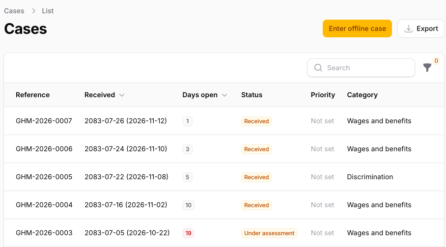
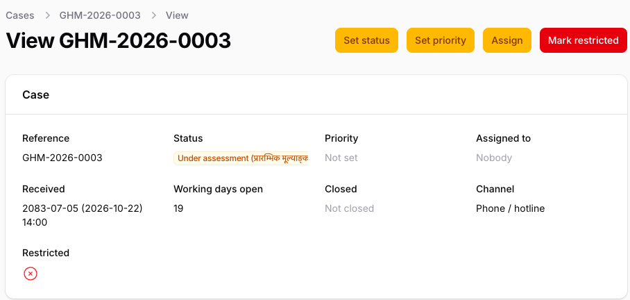
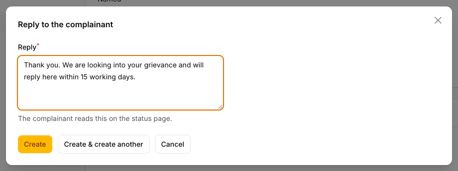
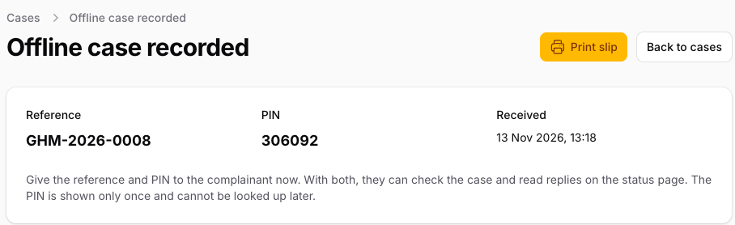
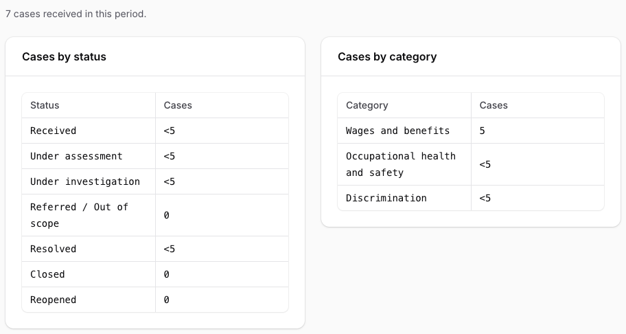

# User guide for focal persons

This guide is for the staff who handle grievances in the staff panel: focal persons, and restricted-case officers, who work the same way on restricted cases. The panel's screens are in English, and this guide shows their labels in **bold**.

## How a grievance moves through the system

1. **It arrives** through the online form (from the company website or the QR poster), or you enter one that came by phone, letter, drop box or in person (section 6).
2. **The complainant gets a reference number and a 6-digit PIN.** With both, they open the status page to see where their case stands and read your replies. They never see staff names, internal notes or staff documents.
3. **You are told by email**, and open the case in the panel.
4. **You work the case:** look into it, reply, and move it through the statuses until it is resolved or closed. The target is 15 working days.

## 1. Your role

- **Administrator:** sees every case and manages the settings: users, categories, locations and the public notice.
- **Focal person:** sees every case that is not restricted.
- **Restricted-case officer:** sees only the restricted cases.

A case is restricted when its category is restricted (sexual harassment, exploitation and abuse, and reporting wrongdoing) or when someone marks it restricted. Focal persons never see a restricted case: not in the list, the search, the summary, the export or the emails.

Your menu has **Dashboard**, **Cases**, **Summary**, **QR poster**, and **Settings → Holidays**.

## 2. Signing in

Open the staff address the Administrator gives you: the grievance site's address followed by `/admin`.

**The first time.**

1. Enter your **Email address** and **Password** and press **Sign in**.
2. The panel asks you to set up two-factor authentication, a second check with a code from your phone. Install an authenticator app on your phone, such as Google Authenticator or Microsoft Authenticator, and press **Set up**.
3. Scan the QR code with the app. Type the 6-digit code the app shows and your password, and press **Next**.
4. The panel shows 8 **recovery codes**. Write them down and keep them away from your phone. Each works once, in place of the app's code, if your phone is lost. Press **Enable authenticator app**, then **Continue**.

**Every day.** Your email and password, then, under **Verify your identity**, the 6-digit code the app shows at that moment.

**Good to know.** 5 wrong passwords lock the account for 15 minutes. 30 minutes without activity sign you out, and anything not saved is lost. **Profile**, in the menu under your initials at the top right, changes your password (it asks for the current one) and makes new recovery codes (**Regenerate recovery codes**).

## 3. Email alerts

You get an email:

- for each new grievance (**New grievance received**), except one you entered yourself;
- for each new message from a complainant (**New message on a grievance**): to the person the case is assigned to, or to everyone who can see it when it is assigned to nobody.

The email holds no details of the grievance, on purpose. Press its **Log in to view** button.

When you mark a case restricted, the restricted-case officers are emailed. Set a case to **Critical** when someone is in danger: the Administrator is emailed at once.

## 4. The case list

**Dates.** The panel shows dates in Bikram Sambat (BS), the Nepali calendar, with the international (AD) date in brackets: 2083-07-22 (2026-11-08). When you type or pick a date, in a filter, an offline case or a holiday, use AD. The offline slip shows AD only.

**Cases** lists the cases you can see, newest first (picture 1).

*Picture 1: the case list. The red 19 is an open case past its target of 15 working days.*

- **Find a case:** type its reference number, such as `GHM-2026-0003`, in **Search**.
- **Filter:** the funnel button filters by **Status**, **Category**, **Location**, **Received from**, **Received until** or **Overdue only (over 15 working days)**.
- **Days open** counts working days since the case was received, or last reopened. Saturdays and the holidays in **Settings → Holidays** do not count; Sundays do. The number turns red when an open case passes 15.
- **The count stops** at **Referred / Out of scope**, **Resolved** or **Closed**, and starts again from the day you set **Reopened**.
- **Holidays.** At the start of each year, enter the public holidays: **Settings → Holidays**, **New holiday**, the date and its name. **Edit** corrects one. The counts change overnight. Only the Administrator can delete a holiday, and checks the ones you enter.

## 5. Working a case

Click a reference to open the case (picture 2). Opening a case is recorded in the activity log.

*Picture 2: a case page. The actions are at the top right.*

Its sections are **Case**, **Grievance** (what happened, where and when), **Complainant** (name and contacts, or "Anonymous") and **About the complainant (optional answers)**. Status and category show their Nepali name next to the English, as the complainant reads them. An incident date from the Nepali form is in BS; when the complainant did not remember the day, it shows the month, such as "Kartik 2083, exact day not remembered".

**Set status.** The complainant sees the status on the status page, in their language.

| Status | Nepali | Use it when |
|---|---|---|
| Received | प्राप्त | The case has arrived (set automatically) |
| Under assessment | प्रारम्भिक मूल्याङ्कनको क्रममा | You are checking what the case is about |
| Under investigation | छानबिनको क्रममा | The case is being investigated |
| Referred / Out of scope | अन्यत्र सिफारिश गरिएको / दायराबाहिर | Another body handles it, or it is not a grievance for this system |
| Resolved | समाधान भएको | Action has been taken |
| Closed | बन्द गरिएको | Nothing more will be done; the closing date is recorded |
| Reopened | पुनः खोलिएको | A resolved or closed case needs more work |

A message from the complainant never changes the status: set **Reopened** yourself when a closed case needs more work.

**Set priority:** **Low**, **Medium**, **High** or **Critical**. **Assign** gives the case to one person, or to **Nobody**; it offers only people allowed to see the case.

**Messages, Notes and Documents** are the tabs below the case. A note or reply cannot be edited or deleted once saved, so read it before you press **Create**. (**Create & create another** saves too, then opens an empty form.)

- **Add note:** an internal note with the date and your name. The complainant never sees notes.
- **Send reply:** the complainant reads it on the status page, signed "Grievance team", never with your name (picture 3). Colleagues see who sent it. You can write in Nepali.
- **Upload document:** a JPG, PNG, WebP or PDF of up to 5 MB, such as a scanned letter. The complainant does not see it. A file the complainant attached shows as uploaded by **Complainant**.

*Picture 3: a reply. Press **Create** to send it.*

**Mark restricted** when only restricted-case officers and the Administrator should see a case, for example when it turns out to involve harassment. As soon as you confirm, the case leaves your list, and you cannot undo it. Only the Administrator can remove the mark, with a reason that is kept in **Notes**.

## 6. Grievances received offline

Enter every grievance that arrives another way (phone, email, drop box, in person, letter, meeting, another organisation) so it is handled like any other: **Cases**, **Enter offline case**, then fill in:

- **Channel**, and **Received**: when it reached the company. It cannot be in the future.
- **Category**, **Location**, **When it happened**, **How often** and **Description**. If the complainant knows only the month, tick "The complainant does not remember the day".
- **Complainant's language:** Nepali or English. Any acknowledgement email goes in this language.
- **Anonymous: no name or contact details:** switch it on when none are given. Otherwise give the **Name**, the **Preferred contact**, and a phone or an email: the phone if they prefer phone, the email if they prefer email.

Press **Create**. The **Offline case recorded** page shows the reference number and the PIN (picture 4). The PIN is shown only this once, so give both to the complainant straight away: in person, press **Print slip** and hand them the slip; on the phone, read both out (the system sends no text messages); by email, they also get an acknowledgement email.

*Picture 4: the slip. The PIN is shown only once.*

## 7. Summary and export

**Summary** counts the cases you can see that were received in a date range, by status and by category (picture 5). A count from 1 to 4 shows as **<5**, so nobody in a small group can be picked out. A 0 shows as 0, the line above the tables gives the exact total, and the category table lists only categories that have cases.

*Picture 5: the summary. Wages and benefits had 5 cases; the others had fewer.*

**Export**, on **Cases**, downloads cases as a file: choose **Received from** and **Received until** (this month, unless you change them), **CSV** or **Excel (XLSX)**, then **Download**. Both open in Excel. The file has the reference, the received and closed dates (in AD with the time, and in BS), channel, category, location, priority, status and the optional answers. It never has names or contact details. Every export is recorded in the activity log.

## 8. QR poster

**QR poster** shows a QR code that opens the grievance form on a phone. **Print poster** gives an A4 poster in Nepali and English; **Download QR code (PNG)** gives the code alone.

## 9. Keeping grievances confidential

- **Do not share your account.** Everything you open or change is recorded under your name.
- **Keep details inside the panel,** not in email, chat or documents.
- **Keep downloads and exports** only as long as you need them, never on a shared computer.
- **Sign out** when you finish, from the menu under your initials.
- **Tell the Administrator at once** about anything unusual: an alert you did not expect, or a case you should not see.

## 10. If something goes wrong

| What happens | What to do |
|---|---|
| "Too many login attempts" | Wait 15 minutes, then try again |
| You forgot your password | Ask the Administrator for a new one, then change it on **Profile** |
| Your phone is lost or replaced | Sign in with **Use a recovery code instead**. On **Profile**, press **Turn off** (it takes your password and a second recovery code), then set up the app on the new phone. No codes left: ask the Administrator |
| You were signed out while working | 30 minutes passed without activity. Sign in again; anything not saved is lost |
| No alert emails arrive | Check the spam folder, then tell the Administrator |
| A case is missing from the list | Clear the filters (funnel button). If it was marked restricted, you no longer see it |
| A complainant lost the PIN | It cannot be shown again, by anyone. Tell the Administrator |
| You need a new category or location, or a restricted mark removed | Ask the Administrator |
