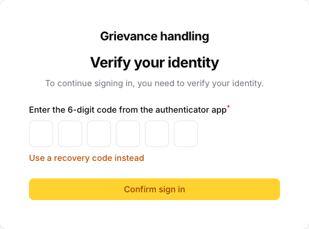

# User guide for focal persons

This guide is for focal persons: the staff who handle grievances in the staff panel. It covers signing in, working a case, entering grievances that arrive offline, and the summary and export. The panel's screens are in English, and this guide quotes their labels in **bold**.

## 1. Your role

There are three roles in the system:

- **Administrator:** sees every case and manages the settings (users, categories, locations, holidays and the public notice).
- **Focal person (you):** sees every case that is not restricted.
- **Restricted-case officer:** sees the restricted cases.

A case is restricted when its category is restricted (for example sexual harassment or abuse) or when someone marks it restricted. Restricted cases never appear for you: not in the list, the search, the summary, the export or the email alerts.

Your menu has four items: **Dashboard**, **Cases**, **Summary** and **QR poster**.

## 2. Signing in

Open the staff address the Administrator gives you. It is the grievance site's address followed by `/admin`.

**The first time.**

1. Enter your **Email address** and **Password** and press **Sign in**.
2. The panel asks you to set up two-factor authentication. Install an authenticator app on your phone, for example Google Authenticator or Microsoft Authenticator.
3. Scan the QR code shown on screen with the app.
4. Type the 6-digit code the app shows, together with your password.
5. The panel then shows your **recovery codes**. Write them down and keep them somewhere safe, away from your phone. Each code works once, and it lets you in if your phone is lost.

**Every day.** Sign in with your email and password, then type the 6-digit code from the app (picture 1). If you do not have your phone, choose **Use a recovery code instead**.

*Picture 1: the second step of signing in.*

**Good to know.**

- **Wrong password:** after 5 wrong tries, your account is locked for 15 minutes. Wait, then try again.
- **Idle sign-out:** after 30 minutes without activity, the panel signs you out. Anything you had not saved is lost, so save your work before you step away.
- **Changing your password:** open the menu under your initials at the top right and choose **Profile**. You need your current password. The same page makes new recovery codes.
- **Lost phone and no recovery codes left:** ask the Administrator.

## 3. Email alerts

You get an email for:

- each new grievance (**New grievance received**)
- each new message from a complainant (**New message on a grievance**)

The email holds no details of the grievance on purpose. Use its **Log in to view** button and read the case in the panel.

You get no email for a restricted case, or for a case you entered yourself.

## 4. The case list

**Cases** lists every case you can see, the newest first (picture 2).

*Picture 2: the case list. The red 30 marks a case open more than 15 working days.*

- **Find a case.** Type its reference number, for example `GHM-2026-0001`, in the **Search** box above the table.
- **Filter the list.** Use the funnel button to filter by **Status**, **Category**, **Location**, a date range (**Received from**, **Received until**), or **Overdue only (over 15 working days)**.
- **Days open** counts working days since the case was received. Saturdays, and the holidays the Administrator enters, do not count. The number turns red when an open case passes 15 working days.
- **When the count stops.** It stops when a case is **Referred / Out of scope**, **Resolved** or **Closed**. If you later set **Reopened**, it counts again from the day the case was received.

## 5. Working a case

Click a reference to open the case (picture 3).

*Picture 3: a case page. The actions are at the top right.*

**What the page shows.** Opening a case is recorded in the activity log. The page has four sections:

- **Case:** reference, status, priority, who it is assigned to, dates and channel
- **Grievance:** what happened, where and when
- **Complainant:** name and contact details, or "Anonymous"
- **About the complainant:** the optional answers

**Set status.** The complainant sees the status on the status page, in the language they chose:

| Status | Nepali | Use it when |
|---|---|---|
| Received | प्राप्त | The case has arrived (set automatically) |
| Under assessment | मूल्याङ्कनमा | You are checking what the case is about |
| Under investigation | छानबिनमा | The case is being investigated |
| Referred / Out of scope | अन्यत्र पठाइएको / दायराबाहिर | Another body handles it, or it is not a grievance for this system |
| Resolved | समाधान भएको | Action has been taken |
| Closed | बन्द | Nothing more will be done; the closing date is recorded |
| Reopened | पुनः खोलिएको | A resolved or closed case needs more work |

A message from the complainant never changes the status. If a closed case needs more work, set **Reopened** yourself.

**Set priority** chooses **Low**, **Medium**, **High** or **Critical**.

**Assign** gives the case to one person. The list offers only people allowed to see the case.

**Notes and replies.** The tabs below the case are **Messages**, **Notes** and **Documents**. Notes and replies cannot be edited or deleted after you press **Create**, so read them before you do.

- **Notes:** **Add note** writes an internal note, with the date and your name. The complainant **never** sees notes.
- **Messages:** **Send reply** writes to the complainant (picture 4). They read it on the status page, signed "Grievance team", never with your name. The tab also shows what the complainant has written.

*Picture 4: a reply. Press **Create** to send it.*

**Documents.** **Upload document** adds a photo or PDF of up to 5 MB, for example a scanned letter. Click a file's name to download it. The complainant does not see documents uploaded by staff. A photo the complainant attached to the form also appears here, as uploaded by **Complainant**.

**Mark restricted.** Use it when a case should be seen only by restricted-case officers and the Administrator, for example when it turns out to involve harassment.

- **You lose access at once.** As soon as you confirm, the case leaves your list.
- **You cannot undo it.** Only the Administrator can remove the mark.

## 6. Grievances received offline

When a grievance arrives by phone, email, the drop box, in person, by letter, at a meeting or through another organisation, enter it so it is handled like any other. On **Cases**, press **Enter offline case**, then fill in:

- **Channel:** **Phone / hotline**, **Email**, **Drop box**, **In person**, **Letter**, **Meeting**, **Referred by another organisation** or **Other**.
- **Received:** when it reached the company. It cannot be in the future.
- **Category**, **Location**, **When it happened**, **How often** and **Description.**
  - If the complainant knows only the month, tick "The complainant does not remember the day".
- **Complainant's language:** Nepali or English. Any acknowledgement email is sent in this language.
- **Anonymous:** switch it on when no name or contact is given. Otherwise a phone number or an email is needed, even when the complainant chooses **Do not contact me** as the preferred contact.

Press **Create**. The **Offline case recorded** page shows the reference number and a PIN (picture 5).

*Picture 5: the slip. The PIN is shown only once.*

Give the reference and PIN to the complainant straight away:

- **In person:** press **Print slip** and hand them the slip.
- **On a phone call:** read both out. The system sends no text messages.
- **By email:** the complainant also receives an acknowledgement email with the reference and PIN.

The PIN cannot be shown again. With the reference and PIN, the complainant can follow the case and reply on the status page.

## 7. Summary and export

**Summary** counts the cases received in a date range, by status and by category (picture 6). It counts only the cases you can see.

*Picture 6: the summary for a chosen date range.*

**Export**, on **Cases**, downloads the cases received in a date range as **CSV** or **Excel (XLSX)**.

- **What the file holds:** the reference, dates, channel, category, location, priority, status and the optional answers.
- **No personal details:** your exports never include names or contact details.
- **Logged:** every export is recorded in the activity log.

## 8. QR poster

**QR poster** shows a QR code that opens the grievance form on a phone. Press **Print poster** for an A4 poster in Nepali and English, or **Download QR code (PNG)** to use the code elsewhere.

## 9. Keeping grievances confidential

- **Do not share your account.** Every case you open and every change you make is recorded under your name.
- **Keep details inside the panel.** Do not copy them into email, chat or documents.
- **Store files with care.** Keep downloaded files and exports only as long as you need them, never on a shared computer.
- **Sign out** when you finish, using the menu under your initials.
- **Report anything unusual:** an alert you did not expect, or a case you should not see. Tell the Administrator straight away.

## 10. Help

For a forgotten password, a lost phone, a new category or location, or a case that needs its restricted mark removed, contact the Administrator.
