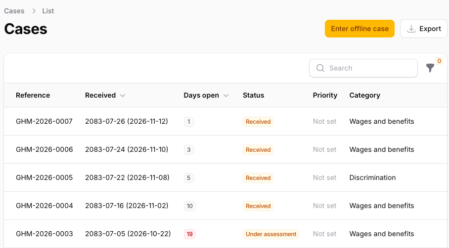
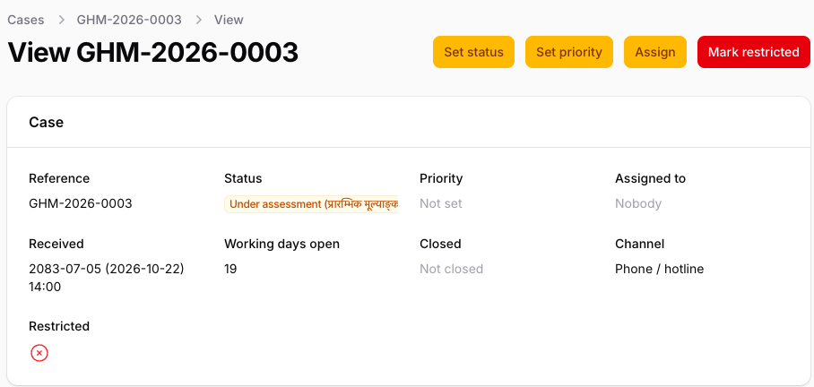
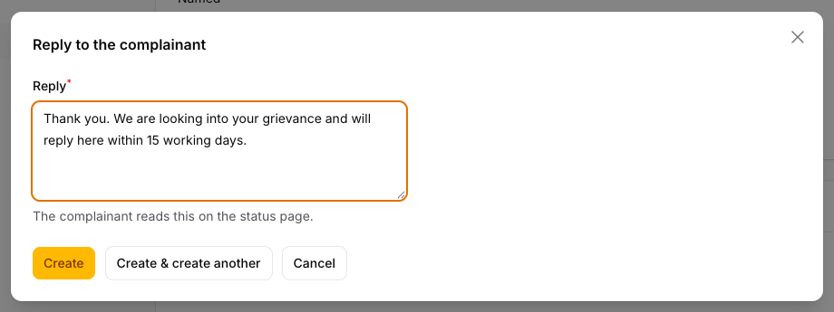
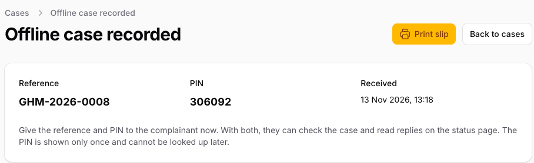
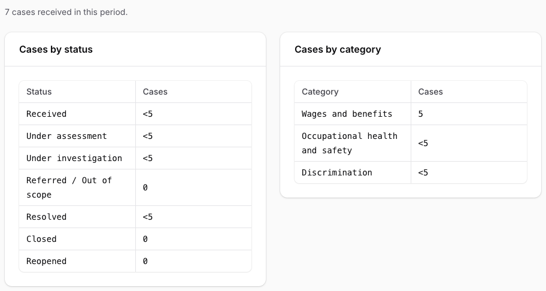

# सम्पर्क व्यक्तिका लागि प्रयोगकर्ता निर्देशिका

यो निर्देशिका कर्मचारी प्यानलमा गुनासो हेर्ने कर्मचारीका लागि हो: सम्पर्क व्यक्ति, र प्रतिबन्धित मुद्दामा यसै गरी काम गर्ने प्रतिबन्धित मुद्दा अधिकृत। प्यानलका स्क्रिन अङ्ग्रेजीमा छन्, त्यसैले स्क्रिनमा देखिने शब्दहरू यहाँ अङ्ग्रेजीमै **बाक्लो अक्षरमा** लेखिएका छन्।

## गुनासो प्रणालीमा कसरी अघि बढ्छ

1. **गुनासो आउँछ** अनलाइन फारमबाट (कम्पनीको वेबसाइट वा QR पोस्टरबाट), वा फोन, चिठी, उजुरी पेटिका वा आफैं उपस्थित भएर आएको गुनासो तपाईं दर्ता गर्नुहुन्छ (खण्ड ६)।
2. **उजुरीकर्ताले सन्दर्भ नम्बर र ६ अङ्कको पिन पाउँछन्।** दुवै प्रयोग गरेर उनीहरूले अवस्था हेर्ने पृष्ठमा आफ्नो मुद्दा कहाँ पुग्यो हेर्न र तपाईंका जवाफ पढ्न सक्छन्। कर्मचारीको नाम, आन्तरिक टिप्पणी वा कर्मचारीले राखेका कागजात उनीहरूले कहिल्यै देख्दैनन्।
3. **तपाईंलाई इमेलबाट जानकारी आउँछ**, र तपाईं प्यानलमा मुद्दा खोल्नुहुन्छ।
4. **तपाईं मुद्दामा काम गर्नुहुन्छ:** छानबिन गर्ने, जवाफ दिने, र समाधान वा बन्द नभएसम्म अवस्था बदल्दै जाने। लक्ष्य १५ कार्यदिन हो।

## १. तपाईंको भूमिका

- **Administrator (प्रशासक):** सबै मुद्दा हेर्छन् र सेटिङ (प्रयोगकर्ता, वर्ग, स्थान र सार्वजनिक सूचना) व्यवस्थापन गर्छन्।
- **Focal person (सम्पर्क व्यक्ति):** प्रतिबन्धित बाहेक सबै मुद्दा हेर्छन्।
- **Restricted-case officer (प्रतिबन्धित मुद्दा अधिकृत):** प्रतिबन्धित मुद्दा मात्र हेर्छन्।

मुद्दाको वर्ग प्रतिबन्धित भएमा (यौनजन्य दुर्व्यवहार, शोषण तथा हिंसा, र गलत कामको सूचना), वा कसैले त्यसलाई प्रतिबन्धित भनी चिनो लगाएमा, मुद्दा प्रतिबन्धित हुन्छ। सम्पर्क व्यक्तिले प्रतिबन्धित मुद्दा कतै देख्दैनन्: सूची, खोज, सारांश, निर्यात वा इमेल कतै पनि।

तपाईंको मेनुमा **Dashboard**, **Cases**, **Summary**, **QR poster** र **Settings → Holidays** छन्।

## २. साइन इन

Administrator ले दिएको कर्मचारी ठेगाना खोल्नुहोस्: गुनासो साइटको ठेगानापछि `/admin`।

**पहिलो पटक।**

1. आफ्नो **Email address** र **Password** लेखेर **Sign in** थिच्नुहोस्।
2. प्यानलले दुई चरणको प्रमाणीकरण (two-factor authentication) मिलाउन भन्छ: फोनको कोडबाट हुने दोस्रो जाँच। फोनमा Google Authenticator वा Microsoft Authenticator जस्तो authenticator एप राखेर **Set up** थिच्नुहोस्।
3. एपले QR कोड स्क्यान गर्नुहोस्। एपले देखाएको ६ अङ्कको कोड र आफ्नो पासवर्ड लेखेर **Next** थिच्नुहोस्।
4. प्यानलले ८ वटा **recovery codes** देखाउँछ। तिनलाई लेखेर फोनभन्दा अलग ठाउँमा सुरक्षित राख्नुहोस्। फोन हराएमा एपको कोडको सट्टा प्रत्येक कोड एक पटक चल्छ। **Enable authenticator app**, अनि **Continue** थिच्नुहोस्।

**हरेक दिन।** इमेल र पासवर्ड, अनि **Verify your identity** मा एपले त्यस बेला देखाएको ६ अङ्कको कोड।

**थाहा पाउनुपर्ने कुरा।** ५ पटक गलत पासवर्ड हालेमा खाता १५ मिनेटका लागि रोकिन्छ। ३० मिनेटसम्म केही नगरेमा प्यानलले साइन आउट गर्छ, र सेभ नगरेको कुरा हराउँछ। माथि दायाँ, तपाईंको नामका आद्याक्षरमुनिको मेनुमा रहेको **Profile** बाट पासवर्ड बदल्न (हालको पासवर्ड चाहिन्छ) र नयाँ recovery codes बनाउन (**Regenerate recovery codes**) सकिन्छ।

## ३. इमेल सूचना

तपाईंलाई इमेल आउँछ:

- प्रत्येक नयाँ गुनासोमा (**New grievance received**), तपाईं आफैंले दर्ता गरेको बाहेक;
- उजुरीकर्ताको प्रत्येक नयाँ सन्देशमा (**New message on a grievance**): मुद्दा जसलाई तोकिएको छ उसलाई, वा कसैलाई नतोकिएको भए मुद्दा हेर्न पाउने सबैलाई।

इमेलमा गुनासोको विवरण जानीजानी राखिँदैन। इमेलको **Log in to view** बटन थिच्नुहोस्।

तपाईंले मुद्दालाई प्रतिबन्धित भनी चिनो लगाउँदा प्रतिबन्धित मुद्दा अधिकृतलाई इमेल जान्छ। कसैको ज्यान वा सुरक्षा खतरामा भए मुद्दालाई **Critical** बनाउनुहोस्: Administrator लाई तुरुन्तै इमेल जान्छ।

## ४. मुद्दाको सूची

**मिति।** प्यानलले मिति विक्रम संवत् (BS) मा, कोष्ठमा अङ्ग्रेजी (AD) मितिसहित देखाउँछ: 2083-07-22 (2026-11-08)। फिल्टर, अफलाइन मुद्दा वा बिदामा मिति लेख्दा वा छान्दा AD प्रयोग गर्नुहोस्। अफलाइन स्लिपमा AD मात्र देखिन्छ।

**Cases** मा तपाईंले हेर्न पाउने मुद्दा, नयाँ सबैभन्दा माथि, देखिन्छन् (चित्र १)।

*चित्र १: मुद्दाको सूची। रातो 19 ले १५ कार्यदिनको लक्ष्य नाघेको खुला मुद्दा देखाउँछ।*

- **मुद्दा खोज्न:** **Search** मा सन्दर्भ नम्बर, जस्तै `GHM-2026-0003`, लेख्नुहोस्।
- **फिल्टर:** फनेल बटनबाट **Status**, **Category**, **Location**, **Received from**, **Received until** वा **Overdue only (over 15 working days)** अनुसार छान्न सकिन्छ।
- **Days open** ले मुद्दा प्राप्त भएको, वा पछिल्लो पटक पुनः खोलिएको, दिनदेखिका कार्यदिन गन्छ। शनिबार र **Settings → Holidays** मा राखिएका बिदा गनिँदैनन्; आइतबार गनिन्छ। खुला मुद्दाले १५ नाघेपछि अङ्क रातो हुन्छ।
- **गन्ती रोकिन्छ** **Referred / Out of scope**, **Resolved** वा **Closed** मा, र तपाईंले **Reopened** गरेको दिनदेखि फेरि सुरु हुन्छ।
- **बिदा।** हरेक वर्षको सुरुमा सार्वजनिक बिदा राख्नुहोस्: **Settings → Holidays**, **New holiday**, मिति र बिदाको नाम। **Edit** बाट सच्याउन सकिन्छ। गन्ती राति बदलिन्छ। बिदा Administrator ले मात्र मेटाउन सक्छन्, र तपाईंले राखेका बिदा उनैले जाँच्छन्।

## ५. मुद्दामा काम गर्ने

मुद्दा खोल्न सन्दर्भ नम्बरमा क्लिक गर्नुहोस् (चित्र २)। मुद्दा खोलेको कुरा गतिविधि अभिलेख (activity log) मा दर्ता हुन्छ।

*चित्र २: मुद्दाको पृष्ठ। कार्यहरू माथि दायाँ छन्।*

पृष्ठका खण्ड **Case**, **Grievance** (के भयो, कहाँ र कहिले), **Complainant** (नाम र सम्पर्क, वा "Anonymous") र **About the complainant (optional answers)** हुन्। अवस्था र वर्ग अङ्ग्रेजीसँगै नेपाली नाममा पनि देखिन्छन्, उजुरीकर्ताले पढेजस्तै। नेपाली फारमबाट आएको घटना मिति BS मा हुन्छ; उजुरीकर्तालाई दिन याद नभएको भए महिना मात्र देखिन्छ, जस्तै "Kartik 2083, exact day not remembered"।

**Set status.** उजुरीकर्ताले अवस्था पृष्ठमा आफ्नो भाषामा अवस्था देख्छन्।

| Status | नेपाली | कहिले प्रयोग गर्ने |
|---|---|---|
| Received | प्राप्त | मुद्दा आइपुग्यो (आफैं सेट हुन्छ) |
| Under assessment | प्रारम्भिक मूल्याङ्कनको क्रममा | मुद्दा केबारे हो भनी जाँच्दै हुनुहुन्छ |
| Under investigation | छानबिनको क्रममा | मुद्दाको छानबिन हुँदैछ |
| Referred / Out of scope | अन्यत्र सिफारिश गरिएको / दायराबाहिर | अर्को निकायले हेर्छ, वा यो प्रणालीको गुनासो होइन |
| Resolved | समाधान भएको | कारबाही गरिसकियो |
| Closed | बन्द गरिएको | थप केही गरिँदैन; बन्द भएको मिति दर्ता हुन्छ |
| Reopened | पुनः खोलिएको | समाधान वा बन्द भएको मुद्दामा थप काम चाहिन्छ |

उजुरीकर्ताको सन्देशले अवस्था कहिल्यै बदल्दैन: बन्द मुद्दामा थप काम चाहिए आफैं **Reopened** गर्नुहोस्।

**Set priority:** **Low**, **Medium**, **High** वा **Critical**। **Assign** ले मुद्दा एक जनालाई, वा **Nobody** लाई, तोक्छ; मुद्दा हेर्न पाउनेहरू मात्र सूचीमा आउँछन्।

**Messages**, **Notes** र **Documents** मुद्दामुनिका ट्याब हुन्। सेभ गरेपछि टिप्पणी वा जवाफ सच्याउन वा मेटाउन सकिँदैन, त्यसैले **Create** थिच्नुअघि पढ्नुहोस्। (**Create & create another** ले पनि सेभ गर्छ, अनि खाली फारम खोल्छ।)

- **Add note:** मिति र तपाईंको नामसहितको आन्तरिक टिप्पणी। उजुरीकर्ताले टिप्पणी कहिल्यै देख्दैनन्।
- **Send reply:** उजुरीकर्ताले अवस्था पृष्ठमा "Grievance team" (गुनासो टोली) को नाममा पढ्छन्, तपाईंको नाम कहिल्यै देखिँदैन (चित्र ३)। सहकर्मीहरूले कसले पठायो देख्छन्। नेपालीमा लेख्न सकिन्छ।
- **Upload document:** ५ MB सम्मको JPG, PNG, WebP वा PDF, जस्तै स्क्यान गरिएको चिठी। उजुरीकर्ताले यो देख्दैनन्। उजुरीकर्ताले जोडेको फाइल **Complainant** ले अपलोड गरेको भनी देखिन्छ।

*चित्र ३: जवाफ। पठाउन **Create** थिच्नुहोस्।*

**Mark restricted** त्यस बेला प्रयोग गर्नुहोस् जब मुद्दा प्रतिबन्धित मुद्दा अधिकृत र Administrator ले मात्र हेर्नुपर्छ, जस्तै मुद्दा पछि उत्पीडनसम्बन्धी देखिएमा। पुष्टि गर्नेबित्तिकै मुद्दा तपाईंको सूचीबाट हट्छ, र तपाईं यसलाई फिर्ता गर्न सक्नुहुन्न। चिनो Administrator ले मात्र हटाउन सक्छन्, कारणसहित, र त्यो कारण **Notes** मा रहन्छ।

## ६. अफलाइन आएका गुनासो

अन्य तरिकाले आएका हरेक गुनासो (फोन, इमेल, उजुरी पेटिका, आफैं उपस्थित, चिठी, बैठक, अर्को संस्था) अरूजस्तै हेरियोस् भनेर दर्ता गर्नुहोस्: **Cases**, **Enter offline case**, अनि भर्नुहोस्:

- **Channel**, र **Received**: गुनासो कम्पनीमा आइपुगेको समय। यो भविष्यको हुन सक्दैन।
- **Category**, **Location**, **When it happened**, **How often** र **Description**। उजुरीकर्तालाई महिना मात्र थाहा भए "The complainant does not remember the day" मा चिनो लगाउनुहोस्।
- **Complainant's language:** Nepali वा English। प्राप्ति इमेल गए यही भाषामा जान्छ।
- **Anonymous: no name or contact details:** नाम र सम्पर्क नदिएमा खोल्नुहोस्। नत्र **Name**, **Preferred contact**, र फोन वा इमेल दिनुहोस्: फोन रोजेमा फोन, इमेल रोजेमा इमेल।

**Create** थिच्नुहोस्। **Offline case recorded** पृष्ठले सन्दर्भ नम्बर र पिन देखाउँछ (चित्र ४)। पिन यही एक पटक मात्र देखिन्छ, त्यसैले दुवै तुरुन्तै उजुरीकर्तालाई दिनुहोस्: आफैं उपस्थित भए **Print slip** थिचेर स्लिप दिनुहोस्; फोनमा दुवै पढेर सुनाउनुहोस् (प्रणालीले SMS पठाउँदैन); इमेल दिएका भए उनीहरूले प्राप्ति इमेल पनि पाउँछन्।

*चित्र ४: स्लिप। पिन एक पटक मात्र देखिन्छ।*

## ७. सारांश र निर्यात

**Summary** ले तपाईंले हेर्न पाउने र तोकिएको मिति अवधिमा प्राप्त मुद्दा अवस्था र वर्ग अनुसार गन्छ (चित्र ५)। १ देखि ४ सम्मको सङ्ख्या **<5** देखिन्छ, ताकि सानो समूहको कसैलाई चिन्न नसकियोस्। ० लाई ० नै देखाइन्छ, तालिकामाथिको लाइनले ठ्याक्कै जम्मा सङ्ख्या दिन्छ, र वर्ग तालिकामा मुद्दा भएका वर्ग मात्र देखिन्छन्।

*चित्र ५: सारांश। Wages and benefits मा ५ मुद्दा थिए; अरूमा त्योभन्दा कम।*

**Cases** मा रहेको **Export** ले मुद्दा फाइलमा डाउनलोड गर्छ: **Received from** र **Received until** (नबदलेसम्म यही महिना), **CSV** वा **Excel (XLSX)** छानेर **Download** थिच्नुहोस्। दुवै Excel मा खुल्छन्। फाइलमा सन्दर्भ नम्बर, प्राप्त र बन्द मिति (समयसहित AD मा, र BS मा), च्यानल, वर्ग, स्थान, प्राथमिकता, अवस्था र ऐच्छिक उत्तर हुन्छन्। नाम वा सम्पर्क विवरण कहिल्यै हुँदैन। हरेक निर्यात गतिविधि अभिलेखमा दर्ता हुन्छ।

## ८. QR पोस्टर

**QR poster** ले फोनमा गुनासो फारम खोल्ने QR कोड देखाउँछ। **Print poster** ले नेपाली र अङ्ग्रेजीमा A4 पोस्टर दिन्छ; **Download QR code (PNG)** ले कोड मात्र दिन्छ।

## ९. गुनासो गोप्य राख्ने

- **आफ्नो खाता अरूलाई नदिनुहोस्।** तपाईंले खोलेको वा बदलेको सबै कुरा तपाईंकै नाममा दर्ता हुन्छ।
- **विवरण प्यानलभित्रै राख्नुहोस्,** इमेल, च्याट वा कागजातमा होइन।
- **डाउनलोड र निर्यात गरिएका फाइल** चाहिएसम्म मात्र राख्नुहोस्, साझा कम्प्युटरमा कहिल्यै होइन।
- काम सकेपछि आद्याक्षरमुनिको मेनुबाट **Sign out** गर्नुहोस्।
- **असामान्य कुरा तुरुन्तै Administrator लाई भन्नुहोस्:** अनपेक्षित इमेल, वा तपाईंले देख्न नहुने मुद्दा।

## १०. केही गडबड भएमा

| के भयो | के गर्ने |
|---|---|
| "Too many login attempts" | १५ मिनेट पर्खेर फेरि प्रयास गर्नुहोस् |
| पासवर्ड बिर्सनुभयो | Administrator सँग नयाँ पासवर्ड माग्नुहोस्, अनि **Profile** मा बदल्नुहोस् |
| फोन हरायो वा फेरियो | **Use a recovery code instead** बाट साइन इन गर्नुहोस्। **Profile** मा **Turn off** थिच्नुहोस् (पासवर्ड र अर्को एउटा recovery code चाहिन्छ), अनि नयाँ फोनमा एप मिलाउनुहोस्। कोड बाँकी छैन भने Administrator लाई भन्नुहोस् |
| काम गर्दागर्दै साइन आउट भयो | ३० मिनेट केही गरिएन। फेरि साइन इन गर्नुहोस्; सेभ नगरेको कुरा हराउँछ |
| सूचना इमेल आएन | स्प्याम फोल्डर हेर्नुहोस्, अनि Administrator लाई भन्नुहोस् |
| सूचीमा मुद्दा देखिएन | फिल्टर हटाउनुहोस् (फनेल बटन)। प्रतिबन्धित भनी चिनो लागेको भए अब तपाईं देख्नुहुन्न |
| उजुरीकर्ताले पिन हराए | पिन फेरि कसैले पनि देखाउन सक्दैन। Administrator लाई भन्नुहोस् |
| नयाँ वर्ग वा स्थान चाहियो, वा प्रतिबन्धित चिनो हटाउनुपर्यो | Administrator लाई भन्नुहोस् |
